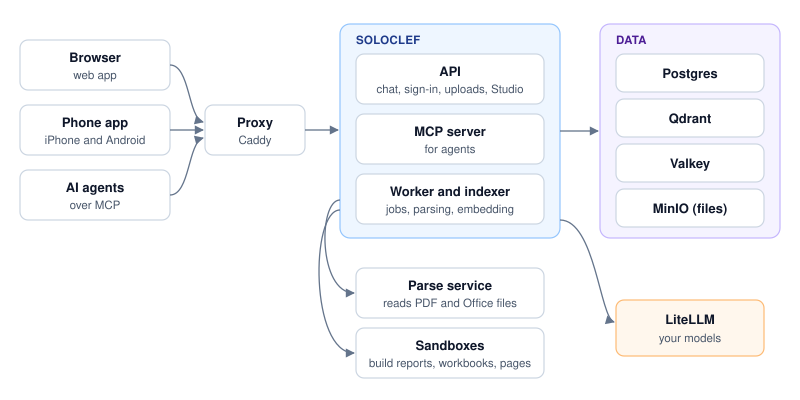

# Soloclef Notes

Soloclef is a self-hosted research notebook. Add your material to a notebook,
ask questions and get answers that cite the exact passage they came from, then
turn your sources into reports, slide decks, podcasts, videos, flashcards and
quizzes. It runs on your own server, with your own models, and comes with a web
app, an iPhone app and an MCP server for AI agents.

## Features

**Notebooks and sources**
- Upload PDF, Word, PowerPoint, EPUB, text, Markdown, CSV and HTML files, and
  pictures (described by a vision model if you ask).
- Import from Google Drive, Nextcloud and web pages. A link to a PDF is stored
  and read like an upload.
- Search PubMed, arXiv, medRxiv/bioRxiv, Exa and Tavily and add results as
  sources. Fast research returns snippets; deep research also reads the top
  pages and open full texts.
- A notebook's chat searches PubMed, arXiv and bioRxiv/medRxiv when its
  sources don't answer, and adds papers and pages for you, by PubMed id, DOI,
  arXiv id or link, with open full texts where they exist. Papers are added
  at once; a web page waits for your approval.
- Files are read locally with pymupdf4llm by default, or with Datalab,
  LlamaParse or Unstructured if you add a key.

**Chat**
- Answers come from the sources you tick, with numbered citations; click one to
  open the passage.
- The chat can also read your connected mail, Google Drive, Nextcloud and MCP
  servers when you ask about them. Each connection has its own switch.
- The chat draws charts and diagrams in its answers when they help: bar, line
  and clinical charts, flowcharts, timelines, comparison tables and concept
  maps, in light and dark.
- Copy an answer with its formatting, or download it as Markdown, with a list
  of sources at the end.
- What the chat makes in a notebook is listed in that notebook's Studio.
- Every tool runs without asking unless you mark it "Ask first" in Settings,
  except adding a web page to a notebook, which always asks.
- The assistant keeps a memory of you that you can read and edit.

**Studio**
- Reports (PDF, Word, web page), slide decks, spreadsheets, mind maps,
  infographics, flashcards, quizzes, data tables, two-voice audio overviews and
  narrated video overviews.
- Infographics are posters drawn by the application: key numbers, short
  sections, and charts or diagrams where they show something, in one of six
  looks and three page shapes, kept as PNG and SVG.
- Slide decks are drawn in designed themes from the model's content: titles,
  bullets, columns, comparisons, quotes, timelines, diagrams and bar charts,
  with speaker notes and cited sources. They open in PowerPoint with every
  shape editable.
- Video overviews are narrated decks, each part animated as the narration
  reaches it. Every part has its own passage, voiced on its own, so a point
  comes in when its words begin, not at a guessed moment.
- Slide text is sized to its place and never below a readable size. When it
  does not fit, the slide is laid out another way first: figures two to a
  row or one to a row, a timeline's events above and below its line, a
  diagram's stages on two rows. A web address wider than the slide is broken
  after a slash or a hyphen.
- Decks and documents are checked against layout rules (text in its box,
  nothing overlapping, readable size and contrast) before they are saved.
- Start several outputs at once: one that needs a sandbox while all of yours
  are busy waits for one, in turn, instead of failing.
- A failed output says why in plain words in your inbox.

**Notes and automations**
- Save answers as notes or write your own, in a notebook or on their own.
- Automations run a task on a schedule or on an event, with the chat's tools,
  and save or email the result.
- Describe an automation in a notebook's chat. The assistant asks about
  anything missing, says what an automation can't do, and drafts it on a card
  you can edit. Nothing is saved until you press Create.

**Mail**
- Connect IMAP, Microsoft 365 or a Stalwart (JMAP) mailbox. The assistant can
  search and read mail and attachments, and write drafts.
- Nothing is sent until you press Send on the draft, which shows exactly what
  will go out. Unusual messages (many recipients, new recipients, large
  attachments, many sends in an hour) need an extra confirmation. Drafts from
  automations wait on a Drafts page.

**Sharing and notifications**
- Share a finished Studio output (mind map, report, deck, flashcards, quiz,
  audio, video, infographic, data table) with a read-only public link that
  expires or that you revoke. Chats and notebooks stay private.
- An inbox, and push notifications on iPhone and Android when an output is
  ready, an import fails, an automation finishes or a draft is waiting. Each
  kind can be switched off, with quiet hours.
- Open tabs and the phone app update by themselves: an upload turning ready,
  a Studio output's progress, a new chat message or inbox row shows without a
  reload, in every tab and device signed in to the account.

**Accounts**
- Email and password, optional single sign-on through any OpenID Connect
  provider, and password reset by email. Sign-ups can be switched off.
- Signing out, a password change or "sign out everywhere" ends sessions
  immediately. The phone stays signed in while you use it and signs out after
  180 days unused.
- Change your password, see every signed-in device and sign any one out, or
  sign out everywhere, on the website and in the phone app.
- Bring your own models: connect any OpenAI-compatible API with your own key,
  alongside the models the server provides.

**For agents**
- An MCP server (Streamable HTTP at `/mcp`, or stdio) lets Claude Code, Cursor
  and other agents search and read your notebooks and notes, with an API key.
- Add your own MCP servers (Streamable HTTP or SSE, with API key, bearer token
  or OAuth sign-in). Their secrets are encrypted at rest.

## How it fits together



## Deploy

Soloclef runs with Docker Compose. You need Docker Engine 24+ with Compose v2,
about 25 GB of disk, and a [LiteLLM](https://github.com/BerriAI/litellm) proxy
with a chat model, an embedding model (BGE-M3) and, for audio, a speech model.

```bash
git clone <this repository> soloclef && cd soloclef
cp docker/.env.go.example docker/.env.go
```

Edit `docker/.env.go`; every setting is described there. Then create the
secret files:

```bash
mkdir -m 700 docker/secrets-go && cd docker/secrets-go
openssl rand -hex 24 > postgres_password
openssl rand -hex 32 > session_secret
printf '%s\n' "your LiteLLM key" > litellm_key
printf '%s\n' "soloclef" > s3_access_key
openssl rand -hex 24 > s3_secret_key
openssl rand -hex 32 > sandbox_api_key   # only if Studio sandboxes are on
chmod 0444 * && cd ../..
```

Start it:

```bash
docker compose -p soloclefgo --env-file docker/.env.go \
  -f docker/docker-compose.go.yml up -d --build
```

Put your HTTPS proxy in front of `SOLOCLEF_GO_SITE_PUBLISH`, then create the
first account:

```bash
dc() { docker compose -p soloclefgo --env-file docker/.env.go -f docker/docker-compose.go.yml "$@"; }
printf '%s\n' "your password" | dc exec -T api soloclef-api set-password you@example.com
dc exec api soloclef-api set-admin you@example.com true
```

To update, pull and run the same `up -d --build`; migrations run first.
An update can run at any time. It waits for work in progress before
restarting a service: up to 5 minutes for the API (Studio outputs and chat
answers, with the site still answering meanwhile) and up to 15 minutes for
the worker (videos, audio overviews, automations), and not at all when
nothing is running. A Studio output still running after that is made again
by the new version and shows as still being made
([details](docs/operations.md#what-an-update-does-to-work-in-progress)).
Phone apps already installed keep working across updates: every request the
installed App Store versions and their over-the-air updates make is tested
against the server and a real database before a change is released, and
`soloclef-api app-versions` shows which versions and updates phones still
use.

Tabs left open across an update keep working: the `site_assets` volume keeps
the web app's code files of each earlier build for 14 days after it was
replaced, for the 20 most recent builds at most. Deleting the volume is safe;
open tabs then reload once.

## Documentation

The full guide is in [`docs/`](docs/) and on the documentation site: every
feature, how to use it, and how to set up single sign-on, email, Google Drive,
Microsoft and Stalwart mail, push notifications and Studio.


## Licence

Apache License 2.0 (see [`LICENSE`](LICENSE)). Soloclef started as a fork of
[SurfSense](https://github.com/MODSetter/SurfSense). The parse service uses
MuPDF, which is AGPL.
