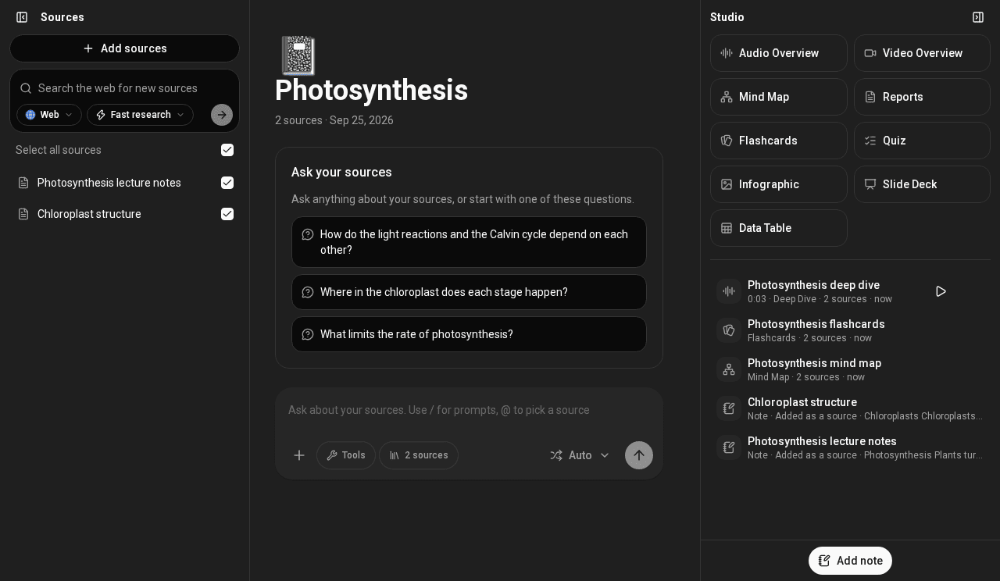

# Getting started

Soloclef is a notebook for study and research. You put your material into a
notebook, ask questions about it, and turn it into things you can learn
from. Every answer shows the passage it came from.

- Sources: upload files, pick them from Google Drive or Nextcloud, or search
  PubMed, arXiv, medRxiv, bioRxiv and the web and add what you find.
- Chat: each notebook has a chat that answers from its sources, with
  numbered citations you can open.
- Studio: reports, slide decks, data tables, mind maps, infographics,
  flashcards, quizzes, audio overviews and video overviews, made from your
  sources.
- Notes: keep answers, write your own, and let a notebook read them.
- Automations: tasks the assistant runs on a schedule, such as a weekly
  digest, saved as a note or emailed to you.
- Email: let the assistant read your mailboxes, and draft messages you send
  yourself.

Everything you add is private to your account.

## 1. Sign in

Open your server's address and sign in with your email and password, or with
the single sign-on button if the server has one. If you don't have an
account yet, choose Sign Up when the server offers it, or Request access when
it does not.

Forgot Password? emails you a link to choose a new password. More on signing
in is in [Account and security](account-and-security.md).

## 2. Find your way around

The narrow bar on the left, the rail, holds everything:

- Home, at the top: your notebooks.
- Notes: all your notes.
- The bell: your [notifications](notifications.md).
- Your avatar, at the bottom: Settings, Connect your agent, Notifications,
  the theme, the language, Learn more for these docs, and Logout.

On a phone, the menu button at the top left opens the same things.

## 3. Make a notebook

On the home page, choose New notebook. It opens straight away. You don't
have to name it: it names itself after its first source or your first
question. You can rename it at any time by editing its title.

## 4. Add a source

Choose Add sources, or drop files onto the notebook. You can upload files,
pick documents already in your library, pick files from Google Drive or
Nextcloud once connected, or search for new sources in the box at the top of
the Sources panel.

Each source is read in the background and shows its progress until it is
ready. See [Notebooks and sources](notebooks-and-sources.md).

## 5. Ask

Once a source is ready, the chat suggests a few questions. Pick one or type
your own. The answer comes from your sources, with numbered citations. Click
a number to see the exact passage. See
[Chat and citations](chat-and-citations.md).

## 6. Make something

In Studio, on the right, pick an output, such as an audio overview, a mind
map or a quiz, and choose Generate. It takes a few minutes and appears in
the Studio list when ready. See [Studio](studio.md).

## Next

- Connect your mail, Drive or other services: [Connectors](connections.md).
- Use your notebooks from your phone: [Phone app](mobile-app.md).
- Work with your notebooks from Claude, ChatGPT or a coding agent:
  [Connect your agent](connect-your-agent.md).
