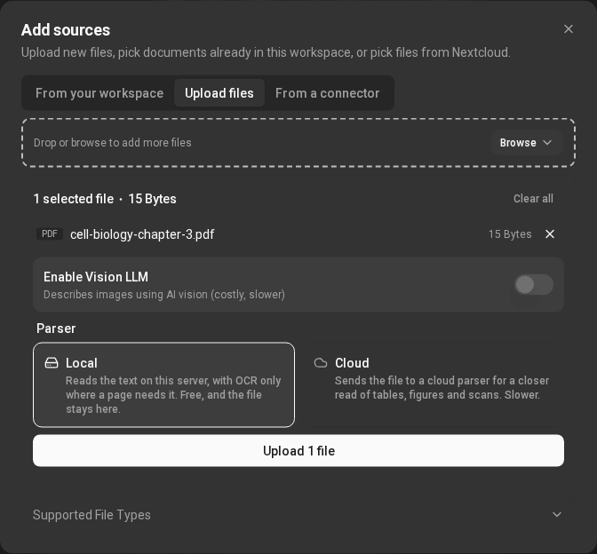

# Notebooks and sources

A notebook holds a set of sources: files, web pages, papers and notes. The
chat and Studio work only from the sources that are ticked in its Sources
panel.

## Notebooks

Your notebooks are on the home page. Choose New notebook, or Create notebook
in an open notebook's header, to start one. A new notebook is called
"Untitled notebook" until you name it, and names itself after its first
source or your first question if you don't.

- Rename a notebook by editing its title in the header, or with Rename in its
  card's menu on the home page. Change its emoji with Change icon.
- Pin to featured keeps a notebook at the top of the home page. Remove from
  featured undoes it.
- Copy notebook makes a new notebook, called "(copy)", with the same sources,
  icon and chat settings. Notes, chats and Studio outputs are not copied.
- Delete, in the card's menu, deletes the notebook with its Studio outputs,
  and ends their public links. The documents stay in your library, its notes
  stay on the Notes page, and its chat is kept as a chat outside any
  notebook. To delete the chat too, use Delete chat history first.

The notebook's own menu also has Configure chat and Delete chat history (see
[Chat and citations](chat-and-citations.md#configure-chat)), and Customize
notebook for the name and emoji.

## The Sources panel

Each source has a tick box. Untick a source to leave it out of answers and
outputs without removing it. Select all sources ticks them all.

A new source shows its progress, such as "Reading the file" or "Embedding",
until it is ready. A source that could not be read says "Indexing failed".

Click a source to read its source guide, a short summary of what it covers.
A source's menu has:

- Remove from notebook, which takes it out of this notebook only. The
  document stays in your library.
- Re-index…, which reads the file again. You can choose a different parser
  here if the first one read it badly.
- Refresh from Nextcloud, for a file picked from Nextcloud.

## Adding sources

Choose Add sources, or drop files on the notebook. The dialog has three tabs:

- From your library: documents and folders you already have.
- Upload files: files from your computer.
- From a connector: files from Google Drive or Nextcloud, once connected.

### Uploading files

These files can be uploaded:

- PDF, Word (.docx), PowerPoint (.pptx) and EPUB files, read by the parser
  you choose.
- Text files of almost any kind: plain text, Markdown, CSV, TSV, HTML, JSON,
  YAML and source code. These are always read on the server.
- Pictures, when Vision is on.
- Other office formats, such as Excel, when the server offers a hosted
  parser that reads them.

The dialog shows the largest file the server accepts and how many files fit
in one upload.

Dropping a single folder keeps its folder structure. Dropping several
folders, or a folder with loose files, adds them as plain files. A drop
opens the Upload files tab with the files filled in, so you can choose the
parser before anything is sent.

### Choosing a parser

- Local reads the file on the server, and the file goes nowhere else. It
  reads the text a file already has, so a scan with no text layer is
  refused.
- Datalab, LlamaParse and Unstructured are hosted services that read scans,
  tables and figures more closely. The file is sent to the service you pick.
  A parser the server has not set up is shown greyed out.

A file is only ever read by the parser you chose. If it cannot read the
file, the upload says so.

### Vision

Enable vision LLM asks a vision model to describe the pictures in PDFs, so
charts and figures can be found and cited. With it on you can also upload
pictures on their own. It is slower, so it starts off. It is only offered
when you or the server have a vision model.

### Google Drive and Nextcloud

Connect them first under Settings, Connectors (see
[Connectors](connections.md)). Then use From a connector.

- Google Drive opens Google's own picker. Pick up to 50 files at a time.
  Folders can't be picked, so pick the files inside them. Google Docs,
  Sheets and Slides are converted on the way in. Picked files are checked
  for changes once a day, or as often as the connection's settings say, and
  read again if they changed in Drive.
- Nextcloud shows your files and folders, with a search box. Pick up to 500
  at a time, then confirm the import. Files are copied once. If one changes
  in Nextcloud, use Refresh from Nextcloud on it.

## Finding new sources

The box at the top of the Sources panel, Search the web for new sources,
finds new material and adds it as sources. Pick where to search:

- Web: Exa or Tavily, with your own key. Until you connect one, it shows
  Not connected and a Connect link.
- Academic: PubMed, arXiv, and medRxiv / bioRxiv, which need no key.
  Results marked Open access have a free full text, which is imported when
  it can be.
- Read a web page: add one page from its link.

Google Scholar is listed but not available: it offers no way for programs to
search it.

Then pick Fast research or Deep research:

- Fast research asks each source for about 10 results, with their snippets.
- Deep research asks for more, about 25 from each academic source. It also
  reads the top 5 web pages and the open full texts of the top 3 PubMed
  papers, so their results carry real passages instead of snippets.

Tick the results you want and add them, up to 50 at a time.

You can also ask the notebook's chat to find and add sources for you (see
[Chat and citations](chat-and-citations.md#adding-sources-from-the-chat)).
It adds them the same way, so a paper added from either place is one source.

Search several at once lets you tick up to 4 places and search them side by
side. Each result then says where it came from, and a place that doesn't
answer is named.

A result that turns out to be a PDF is stored as a PDF and read like an
upload, so it opens and is cited like one. arXiv papers are read from their
PDF.

### Read a web page

Choose Read a web page in the same menu, paste a link and press the arrow.
The page is added as a source and read in the background. A link to a PDF
becomes a PDF source. Only public addresses work. A page already in your
library is added again without being read twice.
