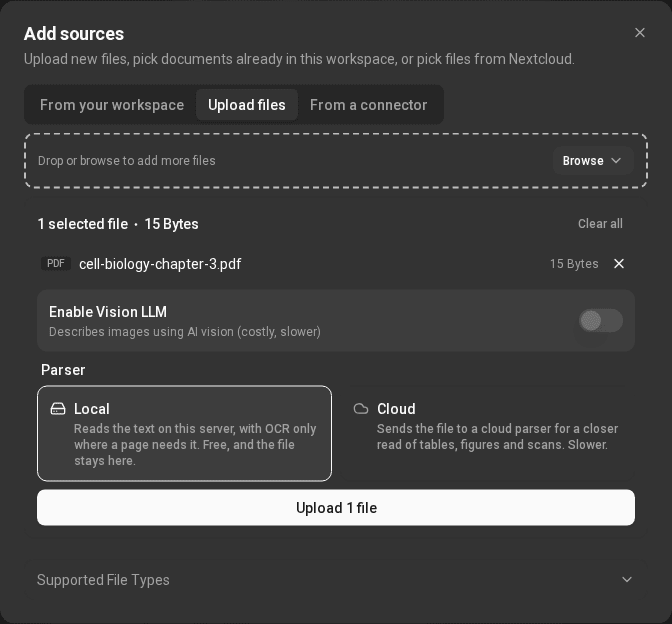

# Notebooks and sources

A notebook holds a set of sources. The chat and Studio only use the sources
that are ticked in the Sources panel. Untick a source to leave it out, or use
Select all sources. Click a source to read its Source guide, an
AI-written summary of what it covers. A citation's Summary button shows
the same guide (see [Chat and citations](chat-and-citations.md#citations)).
A source's menu has Remove from notebook, which takes it out of this
notebook only; the document stays in your library.

## Uploading files

Use Add sources → Upload files, or drag files or whole folders onto the
notebook. Dropped folders keep their structure. The dialog lists the file
types it accepts under Supported File Types. The limit is 500 MB per file.

### Choosing a parser

Before uploading, choose how the file is read:

- Local reads PDF, Word, PowerPoint and EPUB files on this server
  (PyMuPDF4LLM). It is free, and the file never leaves the server. It reads
  the text a file already has: a scan with no text layer is refused.
- Datalab, LlamaParse and Unstructured are hosted parsers, offered
  when the server has a key for them. The file is sent to that service, which
  reads tables, figures and scans more closely. It is slower.

A file is read by the parser you chose and by no other: if that parser cannot
read it, the upload says so rather than trying another. Text, Markdown, CSV
and web pages are read on the server whichever you choose.

If a parser can't read a file type, the dialog tells you which files were
skipped.

### Vision

Enable Vision LLM asks a vision model to describe the images in your
files, so charts and figures can be searched and cited. It is slower, so it
is off by default.

## Connectors

Connectors are set up in Settings → Connectors. Only the ones this server
offers are listed: Google Drive, Nextcloud, Email (IMAP), and MCP servers.

Every connection is your account's own, and it is used by all your notebooks,
chats and automations. Your connectors, on the left of that page, lists them:
pick one to open its settings; a type with more than one connection opens a
list of them. Each connection has an Enabled switch: switched off, it stays
connected but nothing uses it, and it is marked Off in the list and in the
chat's MCP Connectors menu. A type with some connections off shows how many
are on, such as "1 of 2 on".

Disconnect in a connection's settings removes it; Google Drive and Nextcloud
files you already added stay. Email has no Disconnect there: its mailboxes are
removed one by one on its card.

### Google Drive

Choose Connect on the Google Drive card and approve access at Google. The
app asks only for the files you pick: it can't see the rest of your Drive.
You can also connect from a notebook, in Add sources → From a connector.
Finish at Google in the same browser within 10 minutes: Google's page opened
anywhere else (a link someone sent you, another browser) connects nothing,
so nobody can attach your Drive to their account. If it took longer, connect
again.

Then choose Choose files from Google Drive. Google's own picker opens;
pick the files and they are added as sources. Google Docs, Sheets and Slides
are converted on the way in. Picked files are checked once a day and read
again when they changed in Drive. Disconnect removes the app's access at
Google and the connection; files you already added stay.
If Google doesn't confirm that access was removed, the app says so: remove it
yourself under Security → Third-party connections in your Google Account.

### Nextcloud

Choose Connect on the Nextcloud card and sign in to Nextcloud in the tab
that opens; the page connects by itself when you grant access. Then use Add
sources → From a connector to tick files or folders. The Vision and parser
choices are offered here too.

Picked files are copied once. Nothing keeps syncing, so if a file changes in
Nextcloud, use Refresh from Nextcloud in that document's menu.

One import can bring in up to 200 files; for more, pick a smaller folder. Each
file can be up to 500 MB. Folders more than 8 levels deep are folded into the
eighth level. You can start up to 10 Nextcloud sign-ins in 10 minutes.

### Email (IMAP)

Email (IMAP) adds a mailbox the assistant can search and read, read-only.
Mail is read when it is needed and is never imported as a source, and nothing
in the mailbox is ever changed. See [Email](email.md).

### MCP servers

MCPs connects an MCP server, such as Exa or Tavily web search. Research
can then search Exa or Tavily, Read a web page can use a Browserbase
server, and the chat's [Tools](chat-and-citations.md#tools) menu offers
Exa, Tavily and, with a Browserbase server, Browserbase.

Each MCP server you add is your account's own, with your own key: paste its configuration (name, `url`, and the `headers` that carry your
key) and use Test Connection first. Calls go to that server on your key,
so their cost is on your bill with that service. The address must be
`https` on the standard port, a public domain name (not an IP address or a
name that only works inside a network), and reach only public addresses;
anything else is refused. Keys show as `••••` plus their last four
characters to everyone, and are kept when you save without retyping them.
Only you, or an administrator, can change a server you added. Connection
tests are limited to 10 a minute.

The Exa, Tavily and Browserbase servers the site provides are added by an
administrator and limited to an approved list of addresses. Every MCP tool
asks before it runs unless you chose Always allow, and tools that open a
web address always ask.

## Research: search and import

The Search the web for new sources box finds new material and imports it
as sources. Choose where to search:

- Web: Exa and Tavily, which work once you have added their MCP
  connector. Until then they show Not connected. They use your own API
  key for that service.
- Academic: PubMed, arXiv, medRxiv / bioRxiv and Google Scholar. Results
  marked Open access have a free full text, which is imported when it can
  be.

Fast research looks for a handful of good sources. Deep research reads
more widely and ranks what it finds, and takes longer. Tick the results you
want and add them, up to 50 at a time. The box starts on PubMed, which needs
no key.

Some sites, Google Scholar among them, block automated searches from time to
time. If that happens, try
again later or search a different source.

### Read a web page

Read a web page is in the same menu, after Exa and Tavily. Paste a link
and choose Add page: the page is added as a source and read in the
background. If you have a Browserbase MCP server, the page is opened
in a real browser, so pages built with JavaScript work too; otherwise it is
read the same way as search results you add. Only public http and https
addresses are accepted. A page already in your library is linked again, not
read twice.

### Search several at once

Search several at once turns the source menu into tick boxes. Tick up to 4
sources and they are searched side by side, each showing its own progress.
Each result says where it came from, such as From PubMed, and if a source
doesn't answer, the results say so. Your choice is remembered in this
browser.

### Limits

- A query can be up to 500 characters.
- An account can make up to 120 searches a minute, pages read with Read a
  web page included. Agents' academic searches count towards the same limit
  (see [Connect your agent](connect-your-agent.md)).

## Managing notebooks

The notebook menu lets you Copy notebook (with its sources and notes),
Pin to featured on the home page, Configure chat, Customize
notebook (its name and emoji), Delete chat history, Share
notebook… and Share chat publicly… (see
[Settings and sharing](workspaces-and-sharing.md#public-links)). To delete a
notebook, use Delete in its card's menu on the home page. Deleting a
notebook removes its source links; your documents, notes and chats stay in
your library.
