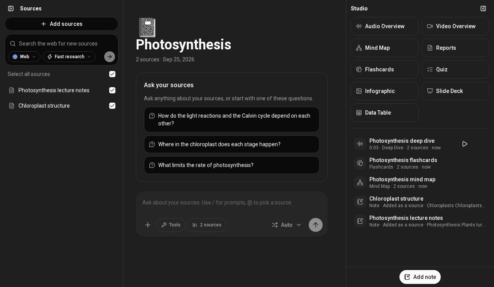

# Overview

*What the app does and where to start*

Soloclef Notes is a notebook app for studying and research. You put your
material into a notebook, then ask questions about it and turn it into things
you can learn from.

- Sources. Upload files, pick files from Google Drive or Nextcloud, or
  search the web, PubMed, arXiv and more and import what you find.
- Chat. Each notebook has one chat. It answers from that notebook's
  sources and shows citations you can open.
- Studio. Two clicks make a report, mind map, infographic, flashcards,
  quiz, slide deck, data table, audio overview or video overview from your
  sources.
- Notes. Save answers as notes, write your own, and turn a note into a
  source.
- Automations. Have the assistant run a task on a schedule, and keep or
  email you the result.
- Email. Connect a mailbox so the assistant can search and read your
  mail, read-only.
- Sharing. Invite people into a workspace, and share a chat, an output or
  a whole notebook by link.

## Where to go next

- [Getting started](getting-started.md): your first notebook in a few minutes.
- [Notebooks and sources](notebooks-and-sources.md): every way to add material.
- [Studio](studio.md): each output and its options.
- [Connect your agent](connect-your-agent.md): use your workspace from Claude Code, Cursor and other agents.
- [Workspaces and sharing](workspaces-and-sharing.md): members, roles, public links and workspace settings.
- [Automations](automations.md): tasks that run on a schedule.
- [Email](email.md): reading your mailbox, and the emails the app sends you.
- [Notifications](notifications.md): the bell, and announcements.
- [Plans and credits](../usage.md): what things cost.
- [Privacy and data](privacy-and-data.md): where your files go.
