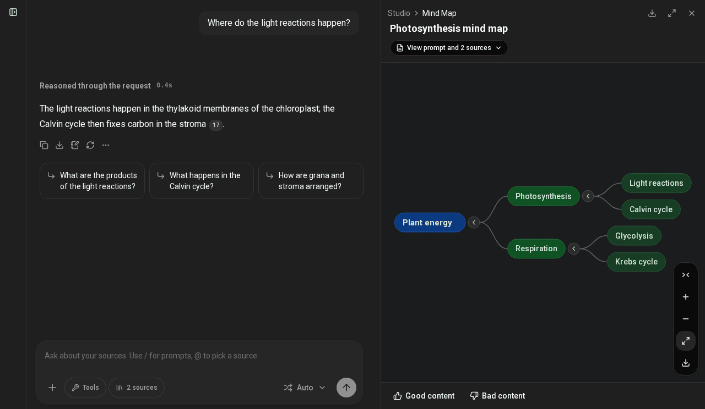
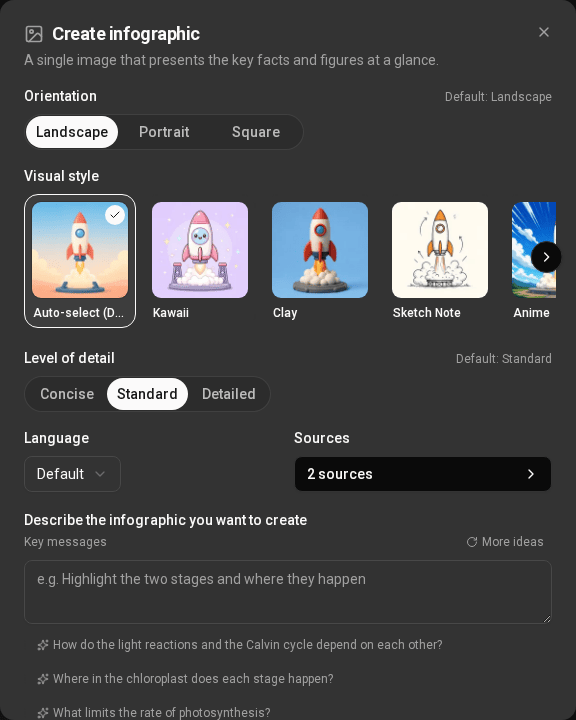
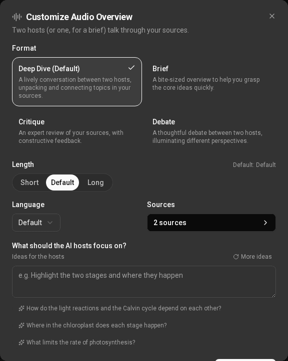

# Studio

Studio turns a notebook's sources into something new: a report, a deck, a
podcast, a quiz and more. It is the panel on the right of a notebook.

Click an output to open its options. Good defaults are already chosen, so you
can press Generate straight away. Every output lets you pick:

- which sources to use;
- the language;
- a focus, in your own words, with a few suggested ideas to start from.

An output takes a few minutes. You can keep working meanwhile. When it is
ready, or if it fails, you get a notification, and a push on your phone if
you use the app. Studio also offers to show a browser notification when an
output you started finishes while the tab is in the background.

## The outputs

### Report

A written report from your sources.

- Format: Document, a PDF or Word file, or Interactive, a page with sections
  to explore that can embed the notebook's other outputs.
- Templates: Briefing doc, Study guide and Blog post for a document, and
  Learning overview for an interactive page. You can edit a template's
  instructions and save them as your default, or choose no template.

A report opens with a contents list. Recommended cards suggest other outputs
for a section. Select a passage and choose Explain to ask the chat about it.

### Slide deck

An editable PowerPoint (.pptx) deck.

- Format: Detailed deck, full text made to be read on its own, or Presenter
  slides, clean slides with talking points in the speaker notes.
- Length: Short, about 6 slides; Default, about 10; or Long, about 16.

### Data table

An Excel workbook of the facts in your sources, laid out in rows. For
example, one row per study with its sample size and main result. Its
formulas are calculated before it is saved, so every cell shows its value in
the viewer as well as in Excel.

### Mind map

A map of the main ideas and how they connect. Level of detail: Overview,
Standard or Detailed. In the viewer you can expand and collapse branches,
zoom, download it as PNG or SVG, and click a topic to ask the chat about it.

### Infographic

A poster of the key facts and figures: a title, a few key numbers, short
sections, and charts or diagrams where they show something, laid out and drawn
by the application from your sources.

- Orientation: Landscape, Portrait or Square.
- Level of detail: Concise, Standard or Detailed: how many sections, points
  and figures the poster holds.
- Visual style: Auto-select, or one of Sketch note, Editorial, Instructional,
  Bento grid, Scientific and Professional.

Every word and number on the poster is the text written for it, never
redrawn by a picture model, and charts place each value exactly. The
infographic is kept as a PNG and as an SVG that stays sharp at any size.

### Flashcards

A study deck, a question on one side and the answer on the other.

- Number: Fewer (10), Standard (20) or More (35).
- Difficulty: Easy, Medium or Hard.

Explain sends a card to the chat for a longer explanation.

### Quiz

Multiple-choice questions with one right answer, scored as you go.

- Number: Fewer (5), Standard (10) or More (20).
- Difficulty: Easy, Medium or Hard.

After you answer, each option says why it is right or wrong. Explain takes
the question to the chat.

### Audio overview

A podcast-style conversation about your sources, read aloud.

- Format: Deep dive, two hosts; Brief, one narrator and a short overview;
  Critique, an expert review in two voices; or Debate, two hosts arguing
  different views.
- Length: Short, 1 to 2½ minutes; Default, 3 to 5½ minutes; or Long, 10 to
  30 minutes. A long episode ends sooner if your sources are thin.

Each speaker gets a different voice. Audio plays in Studio with a transcript.

### Video overview

A narrated, animated explainer video.

- Format: Explainer, a full overview of 6 to 16 scenes, or Short, about a
  minute. No video runs over 10 minutes.
- Choose visual style: Auto-select, Classic, Whiteboard, Playful, Dark,
  Minimal, or Custom, a look you describe.

## Layout checks

Reports, decks and other documents are checked before they are saved. Every
page is drawn and measured:

- every word stays on the page, and no two words overlap;
- on slides, each box's text fits inside its box, text from different boxes
  doesn't overlap, and no line, shape or picture covers text;
- on slides, text is at least 12 point, and at least 16 point in a body of
  three or more paragraphs;
- on slides, text has enough contrast with what is behind it;
- documents have no blank pages, and every font is embedded.

Slides, in decks and in videos, are fitted as they are drawn. Text is sized to
its place, never below what can be read across a room: a figure never smaller
than a slide's title, a body of text never under 16 point. When a slide's text
doesn't fit, the slide is laid out another way before anything is shortened:

- figures go two to a row, then one to a row with each figure beside its
  label;
- a timeline's events take turns above and below the line;
- a diagram's stages go on two rows, and a cycle's cards are widened or set
  out as a loop;
- a comparison's first column narrows to give its cells more room;
- a bar chart's values get a wider column.

A word wider than the whole line, such as a long web address, is broken where
a line may break inside a word: after a slash, a hyphen or a dash. Words are
never hyphenated at a syllable. Text that still doesn't fit goes back to the
model with the slide, the field, the word and the room there is, and the model
rewrites it. A video's deck gets up to two of these rounds; if it still doesn't
fit, the video fails and says which slide and which word.

Whatever fails a check is fixed before the file is saved, and while that
happens the output shows Fixing issues. If it cannot be fixed in time, the
output fails and says why, and you can try again. A file that failed a check
is never saved.

## Managing outputs

What a notebook's chat makes is listed here too, beside what you made in
Studio, and is managed in the same way.

Each output's menu has Open, Try again for one that failed, Rename and
Delete. It also names the model that made it, as Made with …. View prompt
and sources shows the focus and the sources it was made from.

The viewer has Download for every output but flashcards and quizzes, and
Expand to full window. A download is named after the output's title, the
same for every format it comes in.

Deleting an output deletes its file and ends its public link.

A failed output's notification also has Try again, which makes it once more
with the same options and from the same sources. A source removed from the
notebook since is left out. The new output takes the failed one's place in
the list.

## Sharing an output

Only Studio outputs can be shared. Chats, notebooks and sources cannot.

Choose Share publicly in an output's viewer; for an audio overview, it is
the globe button beside the title in Studio's player. In the phone app,
Share publicly is in every output's menu. Pick how long the link lasts:
7 days, which is the default, 30 days, or never. Then copy the link.

Anyone with the link can open the output without signing in, in the same
viewer you see. Visitors can explore a mind map, study flashcards and take a
quiz; their answers stay in their own browser. Nothing else goes with it: not
your sources, your focus, the chat, or the notebook.

Settings, Public links lists every link you have made, with Copy link, Open
link and Revoke. Revoking stops a link at once. An expired link stays in the
list, marked Expired, until you revoke it. Sharing the same output again
gives the same link while it is still valid.

## Which model makes outputs

Settings, Models, Studio outputs model chooses the model that writes every
output. It is your chat model unless you pick another. If the model fails,
the output fails and says so: no other model is tried behind your back.

Your [instructions](memory-and-instructions.md#instructions) also shape every
output's tone, audience and length.

## What the server must offer

Some outputs need parts the server's administrator switches on:

- reports, slide decks and data tables need the server's sandboxes;
- video overviews need video rendering.

If one is missing, asking for that output says it isn't available on this
server.
