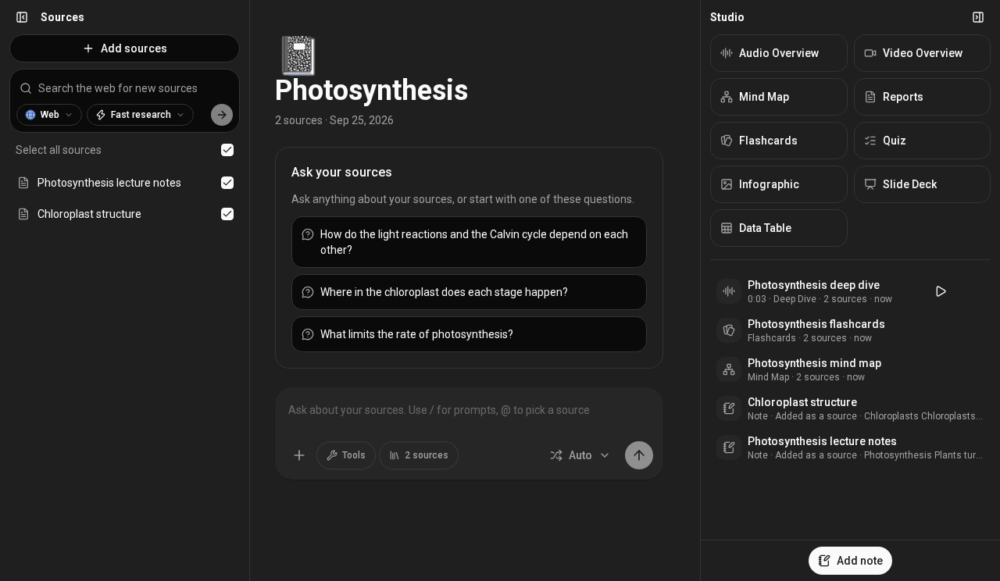
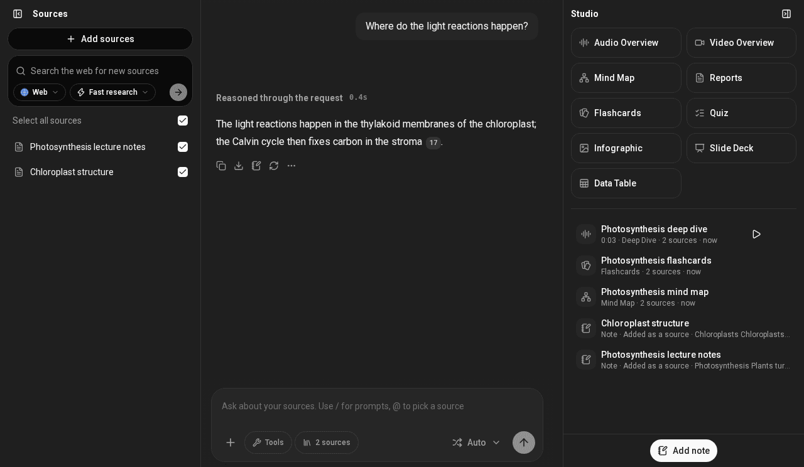

---
hide:
  - navigation
---

# Soloclef Notes

Your own private NotebookLM, on your own server. Put your material in a
notebook (PDFs, lecture notes, web pages, papers, YouTube videos), ask questions
and get answers that cite the exact passage, and turn it into podcasts, videos,
mind maps, quizzes and more. Let the assistant run tasks on a schedule and
email you the result, read your mailbox when you ask, and work with your agents
over MCP.

Nothing is hosted for you and nothing is sold: no trial, no plans, no account
with anyone. You run the server, you choose the models, and your documents stay
on it.

[Run your own server](self-hosting.md){ .md-button .md-button--primary }
[Get the iPhone app](phone-app.md){ .md-button }
[Read the user guide](guide/overview.md){ .md-button }

## Everything it does

| | |
| --- | --- |
| [Sources](guide/notebooks-and-sources.md) | Upload PDFs (scans too), Word, PowerPoint, Excel and images; read on the server by default. Pick files from Google Drive or Nextcloud. Search and import from the web, PubMed, arXiv, medRxiv/bioRxiv, Google Scholar, YouTube (with transcripts), Reddit and more. |
| [Chat with citations](guide/chat-and-citations.md) | One chat per notebook that answers only from the sources you tick, with numbered citations you can open. @-mention a source, choose the model, set instructions. |
| [Studio](guide/studio.md) | Reports, mind maps, infographics, flashcards, quizzes, slide decks, data tables, audio overviews (podcast-style) and video overviews, from the sources you pick. |
| [Notes](guide/notes.md) | Save answers as notes, write your own, and turn a note into a source. |
| [Automations](guide/automations.md) | Tasks the assistant runs on a schedule (hourly, daily, weekdays, monthly): a weekly digest of your notebook, a morning summary of new papers. Results are saved as notes and can be emailed to you. |
| [Email](guide/email.md) | Connect a mailbox (any IMAP account, Gmail or Microsoft) so the assistant can search and read your mail and its attachments, read-only. Mail is read live and never copied into the app. |
| [Workspaces and sharing](guide/workspaces-and-sharing.md) | Invite people with roles, and share a chat, an output or a whole notebook by link. |
| [Agents (MCP)](guide/connect-your-agent.md) | Claude, ChatGPT, Claude Code, Cursor and other agents can search and read your workspace. |
| [Phone app](phone-app.md) | Soloclef for iPhone: notebooks, chat, Studio with background audio, uploads, notifications and changes made offline. |
| [Search](guide/search.md) | Find notebooks, and find things inside their sources and notes. |

## Running it

| Page | What it covers |
| --- | --- |
| [Run your own server](self-hosting.md) | Requirements, the first start, the first account, models |
| [Sign-in](sign-in.md) | Email and password, single sign-on (Pocket ID, Authentik, Keycloak), who can join |
| [Usage and limits](usage.md) | No trials or codes; unlimited use for the admin, and how to give it to others |
| [Phone app](phone-app.md) | The App Store app and connecting it to your server |
| [Updating and backups](operations.md) | Upgrading, and what to back up |
| [Every setting](guide/settings-reference.md) | The full reference for `docker/.env` |

Soloclef Notes is a fork of [SurfSense](https://github.com/MODSetter/SurfSense),
under the Apache License 2.0.
