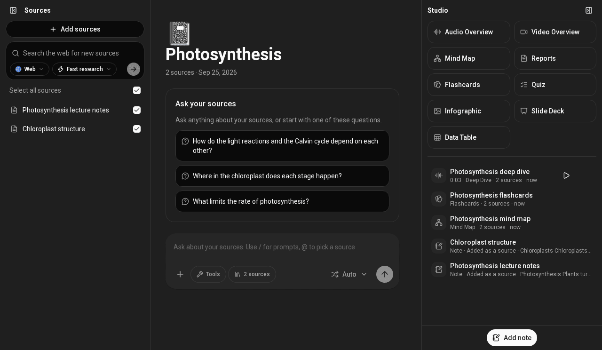
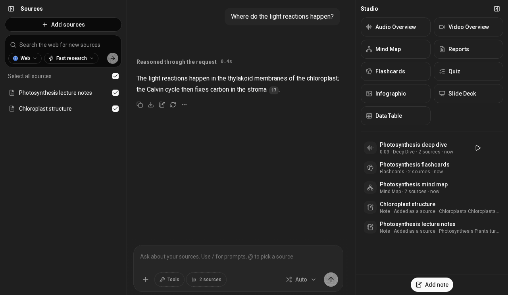

---
hide:
  - navigation
---

# Soloclef Notes

Soloclef is a self-hosted research notebook. Add your material to a notebook,
ask questions and get answers that cite the exact passage they came from,
then turn your sources into reports, slide decks, podcasts, videos,
flashcards and quizzes. It runs on your own server, with your own models,
and comes with a web app, an iPhone app and an MCP server for AI agents.

[Install it](self-hosting.md){ .md-button .md-button--primary }
[Read the user guide](guide/getting-started.md){ .md-button }
[Get the iPhone app](guide/mobile-app.md){ .md-button }

## What it does

| | |
| --- | --- |
| [Sources](guide/notebooks-and-sources.md) | Upload PDF, Word, PowerPoint, EPUB, text and picture files. Pick files from Google Drive or Nextcloud. Search PubMed, arXiv, medRxiv, bioRxiv, Exa and Tavily and add what you find. |
| [Chat](guide/chat-and-citations.md) | Answers from the sources you tick, with numbered citations that open the exact passage. It can also use your mail, Drive, Nextcloud and MCP servers when you ask. |
| [Studio](guide/studio.md) | Reports, slide decks, data tables, mind maps, infographics, flashcards, quizzes, audio overviews and video overviews. Documents are checked for layout before they are saved. |
| [Notes](guide/notes.md) | Keep answers, write your own, and let a notebook's chat read them. |
| [Automations](guide/automations.md) | Tasks that run on a schedule and save or email their result. |
| [Email](guide/email.md) | The assistant reads your IMAP, Microsoft or Stalwart mailbox. It drafts messages, and nothing is sent until you press Send. |
| [Connectors](guide/connections.md) | Google Drive, Nextcloud, mailboxes, Exa and Tavily with your own key, and any MCP server. |
| [Models](guide/models.md) | The server's models, or your own OpenAI-compatible service with your own key. |
| [Notifications](guide/notifications.md) | An inbox and phone pushes, with a switch per kind and quiet hours. |
| [Sharing](guide/studio.md#sharing-an-output) | Share a Studio output with a read-only public link. Everything else stays private. |
| [Phone app](guide/mobile-app.md) | Notebooks, chat, Studio with background audio, notes, automations and the inbox, on iPhone and Android. |
| [Agents](guide/connect-your-agent.md) | Claude, ChatGPT, Claude Code, Cursor and other agents can search and read your documents over MCP. |

## Running it

Soloclef runs with Docker Compose next to a LiteLLM proxy. Every model call
goes through your proxy, so you choose the providers and set the budgets.

| Page | What it covers |
| --- | --- |
| [Install](self-hosting.md) | Requirements, settings, secrets, the first start, https and the first account |
| [Optional features](optional-features.md) | Single sign-on, email, Google Drive, Microsoft and Stalwart mail, phone pushes, Studio sandboxes and hosted parsers |
| [Updating and backups](operations.md) | Upgrading, what to back up, and restoring |
| [Settings reference](settings-reference.md) | Every setting in `docker/.env.go`, by topic |

Soloclef is under the Apache License 2.0. It started as a fork of
[SurfSense](https://github.com/MODSetter/SurfSense).
