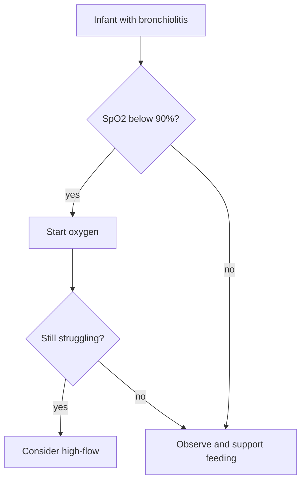

## Oxygen in bronchiolitis

Most guidelines start supplemental oxygen when saturations stay **below 90–92%** [citation:1204]. The NICE guideline uses 90% for children over 6 weeks and 92% for younger infants or those with underlying conditions [citation:1204, doc-88].

| Guideline | Start oxygen below | High-flow |
|---|:-:|---|
| NICE NG9 | 90% (92% if < 6 weeks) | Not routinely |
| AAP 2014 | 90% | Not addressed |
| Unit protocol | 92% | If work of breathing high |

### When to escalate

1. Rising work of breathing despite oxygen [citation:1210]
2. Apnoeas
3. Exhaustion or reduced feeding below **50%** of usual

The trial evidence for high-flow outside intensive care is mixed [citation:https://www.nejm.org/doi/full/10.1056/NEJMoa1714855].
