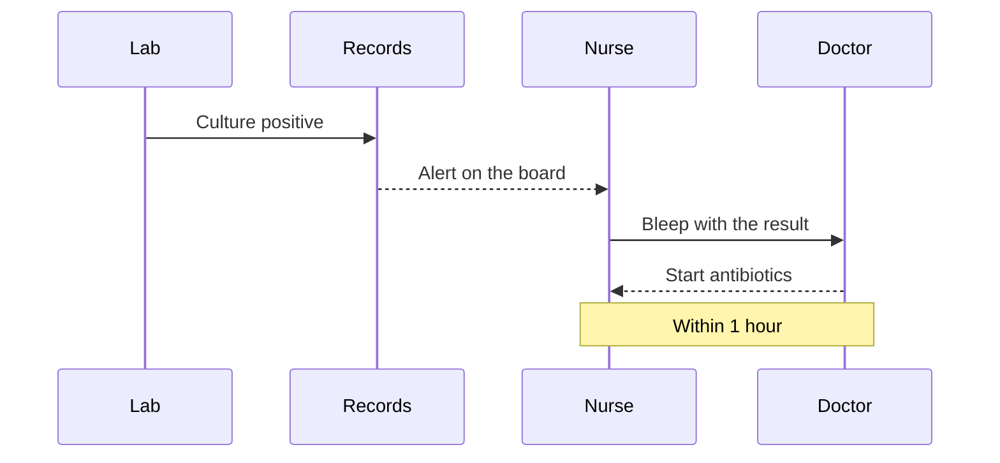

## How a result reaches the ward



The alert payload looks like this:

```json
{
  "patient": "bed-4",
  "result": "Gram-negative rods",
  "priority": "urgent"
}
```

Ask IT to add the ward's bleep to the routing table [citation:3301].
